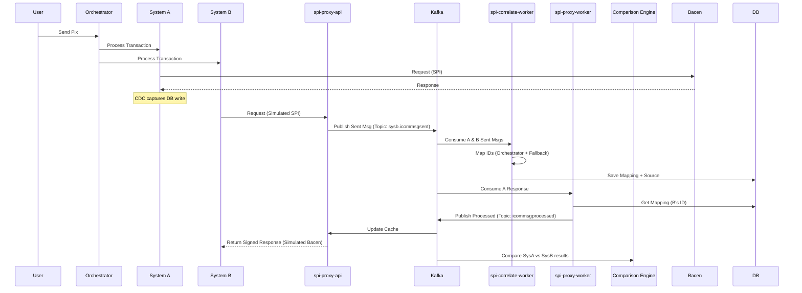

# Pix Coexistence

A Brazilian bank is replacing its proprietary Pix system (**System A**) with an internally developed one (**System B**). This repository holds two independent solutions that let both coexist in front of the Central Bank of Brazil (Bacen):

| | Where | Idea |
|---|---|---|
| **v1** | repository root (`src/`, `tests/`, `tools/`, `infra/`, `ConvivenciaPix.sln`) | System A stays the only connection to Bacen; System B talks to a simulated SPI and receives a mirror of System A's traffic. Specified in "v1 specification" below. |
| **v2** | `v2/` (`ConvivenciaPix.V2.sln`) | A proxy is the SPI endpoint for **both** systems: it forwards what they send to the real SPI and routes what Bacen sends to the right system. |

**The two are totally separate.** v2 has its own solution, props files, tables, Redis channels, Kafka topics, docker-compose and tests. Code that v2 needs from v1 is **copied**, never referenced, and work on one must not touch the other's files.

---

# v2: SPI forwarding proxy

`v2/README.md` is the detailed reference (routing table per message type, guarantees, configuration, local run, cut-over). This section is the summary to work from.

## How it works

* **Sending.** Each system calls `SpiProxyApi` on its own listener port; the port identifies the caller (System A, System B, plus an admin port). The proxy records `MsgId` → system **before** forwarding, forwards the body untouched to the real SPI, and returns Bacen's status, `PI-ResourceId` and body as they came. Nothing is retried towards Bacen.
* **Receiving.** `SpiInboundWorker` is the only consumer of the bank's SPI output stream. For each message it:
  1. verifies Bacen's signature (HSM `VerifyPIX`);
  2. routes each transaction in the message;
  3. builds what each system receives — the whole message, or only that system's transactions when they belong to different systems (split) — and signs it with the bank's HSM (`SignPIX`);
  4. stores the original, the per-system deliveries and the routing decision in one SQL transaction, and only then acknowledges the batch to Bacen.
* **Delivery.** Each system pulls its own queue from the proxy with the usual SPI stream endpoints. SQL is the queue of record (rows leased per stream); Redis only wakes long-polling streams.
* **Audit.** Kafka receives audit events (ids only) through an outbox. It is not part of the message path.

## Routing rules

Each message type has an ordered chain of resolvers (`RoutingTable.Defaults`, overridable in `Routing:Rules`); the first that decides wins, and the decision is stored as `RouteSource`.

| Kind of message | Rule |
|---|---|
| Response to a message a system sent | Back to the sender — by the original message id when the type carries one, otherwise by the transaction (EndToEndId / RtrId / mandate id). The SPI pacs.002 has **no** original message id. |
| Received transfer (pacs.008) and other customer-addressed requests | By the customer's document: present in `TB_DADOS_CONVIVENCIA.Documento` → System B, otherwise System A. Later messages for the same transaction follow it. |
| Not addressed to a customer (admi.004, unsolicited reports) | Both systems. |
| pibr.002 | The system that sent the same content in a pibr.001. |
| Nothing matches | `Routing:DefaultSystem` (System A). |

A message that fails signature verification or is not XML is **quarantined**: stored, delivered to no system, counted in a metric.

## Layout (`v2/`)

| Path | Content |
|---|---|
| `src/Domain`, `src/Application` | routing engine, use cases, ports |
| `src/Infrastructure` | SQL repositories (plain ADO.NET), parser, splitter, HSM signing, SPI gateway, pull loop, outbox, cleanup |
| `src/SpiProxyApi` | the three listeners, SPI endpoints, admin API over the System B document registry |
| `src/SpiInboundWorker` | pulls from Bacen, signs, publishes the audit outbox, purges expired rows |
| `tools/BacenSpiSimulator` | stand-in for the real SPI (local runs and tests) |
| `infra/sql` | v2's tables; idempotent scripts, each starting with `SET QUOTED_IDENTIFIER ON` |
| `tests/Catalog` | examples and schemas of the Bacen SPI catalog 5.13.1 — the reference for the parser, splitter and routing table |

## Rules for working on v2

* **Stack:** .NET 8, Clean Architecture; same conventions as v1 (use-case folders, `XxxOptions`, `[LoggerMessage]`, xUnit + FluentAssertions + Moq, Testcontainers).
* **One database.** v2 has a single connection (`ConnectionStrings:SqlServer`): its tables sit in the same database as `TB_DADOS_CONVIVENCIA`, as in production.
* **`TB_DADOS_CONVIVENCIA` is not owned by v2.** It already exists in that database. v2 reads it and edits rows through the admin API, but never creates or alters the table outside local/dev and test fixtures.
* **Message shapes come from the catalog, not from memory.** When adding or changing a message type, check `tests/Catalog` and keep `SpiCatalogTests` and `SpiMessageSplitterTests` passing. The parser and the splitter must agree on what a transaction is (`SpiTransactionSegments`).
* **Never acknowledge to Bacen before the message is stored**, and never deliver content that has not been signed by the bank's HSM.
* **Bytes, not strings**, for message payloads end to end.
* **Outbound is pass-through.** The proxy does not sign what systems send.
* **In-memory mode is for quick local runs only.** `Storage:Provider=InMemory` (`make run-inmemory`) runs the API and the worker's services in one process with no SQL Server, Redis or Kafka: storage is `Persistence/InMemory`, audit events go to the log. Nothing survives a restart and it is refused in Production. A change to a repository interface must be made in both the SQL and the in-memory implementation.
* **Commands** (from `v2/`): `make infra-up`, `make migrate`, `make migrate-dev-registry`, `make test`, `make run-simulator | run-api | run-worker | run-inmemory`. Infrastructure and Integration tests need Docker, except the `InMemory*` test classes.

## Known limits

* Outside Production the signer is a software stand-in: it does not produce the SPI signature profile and cannot verify real Bacen signatures. Only the real Dinamo HSM path does, and it has not been exercised yet.
* The HSM is part of receiving: if it is down, nothing is acknowledged to Bacen.
* Whether each system can sign its outbound messages with the Bacen-registered key is unconfirmed.

---

# v1 specification: Pix System Migration

> Original specification of the first solution (repository root). Parts of it were superseded during v1's development — `development_plan.md` at the root is closer to what v1 actually does.

## 1. Problem
A proprietary Pix system (**System A**) is currently in use at a Brazilian bank, handling messaging with the Central Bank of Brazil (Bacen). This system is being replaced by an internally developed system (**System B**). Since both cannot connect to the Bacen Pix APIs simultaneously without conflict, a solution is required to allow System B to process requests in parallel for validation (homologation) while System A remains the sole connection point.

## 2. Solution: The Coexistence Layer
The solution maintains System A as the primary interface with Bacen while redirecting System B's traffic to a proxy layer that simulates Bacen's behavior. 

### 2.1 Identification & Correlation
System A and System B generate independent identifiers (e.g., `EndToEndId`). The **spi-correlate-worker** must map these IDs to ensure responses from Bacen are correctly routed to System B.

* **Primary Strategy:** Query the orchestrator data to find the link between System A and System B transaction IDs.
* **Fallback Strategy:** Match by **Timestamp** (within a defined window), **Amount**, and **Payer/Payee details**.
* **Monitoring:** The source of correlation (Orchestrator vs. Heuristic) must be stored in the database and logged to evaluate the accuracy of the fallback strategy.

### 2.2 Idempotency & Error Handling
* **Idempotency:** Handled via the `MessageId` present in every SPI API message. The proxy and workers must use this ID to prevent duplicate processing.
* **Error Simulation:** If System A receives an error response from Bacen, the Coexistence layer must simulate the same error (including error codes and signed XML) for System B.

---

## 3. Architecture

### 3.1 Sequence Diagram

### 3.2 APIs and Workers
* **Stack:** .NET 8, Clean Architecture, and DDD.
* **spi-proxy-api:** * **Caching:** Must implement a distributed cache (e.g., Redis) to store processed responses for quick retrieval by System B.
    * **Timeouts:** Configurable request timeout (default 30s). If the correlation/processing exceeds this, return a specific Bacen-compliant timeout error.
* **Messaging:** * Include **Dead Letter Queues (DLQ)** for every worker to handle processing failures without blocking topics.

### 3.3 Comparison Engine
A dedicated component to validate System B's accuracy against System A.
* **Function:** Consume "Sent" and "Processed" events from both systems.
* **Logic:** Compare business fields (Amount, Beneficiary, Message Type) while ignoring specific identifiers.
* **Output:** Log discrepancies to a dedicated dashboard/table for architectural review.

---

## 4. Database & Infrastructure

### 4.1 SQL Server (`DB_COEXISTENCE`)
The database must store the mapping between systems.

**Table: SpiSentMsg**
* `IdSystemA` (PK, VARCHAR, **Indexed**)
* `IdSystemB` (PK, VARCHAR, **Indexed**)
* `CorrelationSource` (VARCHAR: 'Orchestrator' or 'Heuristic')
* `CreatedAt` (DateTime2)

### 4.2 TTL and Cleanup
* **TTL (Time-To-Live):** Correlation mappings in `SpiSentMsg` should have a retention period of 30 days.
* **Cleanup:** A scheduled job must delete records older than the TTL to maintain performance.

---

## 5. Functional Requirements (RF)

| ID | Requirement | Description |
| :--- | :--- | :--- |
| **RF-01** | **Bacen Emulation** | Emulate Bacen SPI endpoints with mTLS and XML signatures. |
| **RF-02** | **Hybrid Correlation** | Map IDs via Orchestrator data first, then Heuristic (Timestamp/Metadata). |
| **RF-03** | **Idempotency** | Use `MessageId` to prevent duplicate processing in the proxy layer. |
| **RF-04** | **Error Propagation** | Simulate System A's Bacen failures for System B. |
| **RF-05** | **Correlation Logging** | Store and log the `CorrelationSource` for strategy validation. |
| **RF-06** | **Database Indexing** | Implement indexes on System A and System B IDs in the mapping tables. |
| **RF-07** | **Resiliency (DLQ)** | Implement Dead Letter Queues for all Kafka consumers. |
| **RF-08** | **Comparison Reporting** | Compare payloads between systems and flag business logic discrepancies. |
| **RF-09** | **Caching & Timeouts** | Implement response caching and request timeouts in `spi-proxy-api`. |

---

## 6. Development Tools
* **Docker:** Provide a `docker-compose` to spin up SQL Server, Kafka, and the Debezium connector for local development.
* **Signing Mock:** Create a .NET implementation of the Dinamo HSM interface for local XML signing.